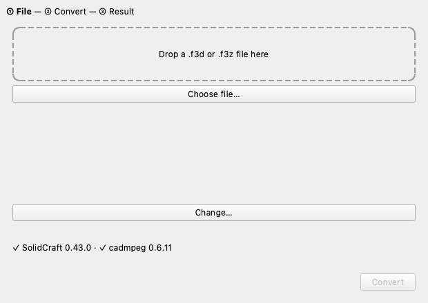

# Guía de f3d2solidcraft

f3d2solidcraft convierte diseños de Autodesk Fusion (`.f3d` y `.f3z`) en diseños editables de
[SolidCraft](https://github.com/tangency-labs/solidcraft). Los parámetros, los bocetos y las operaciones se
reconstruyen como una línea de tiempo de SolidCraft que puedes seguir editando. Lo que todavía no se puede
reconstruir llega como un cuerpo importado, y un reporte indica, operación por operación, qué pasó con cada una.

Cada conversión se compara con el original antes de entregártela: los mismos cuerpos, el mismo volumen (con un
margen de 0,1 %), la misma caja envolvente y el mismo centro de masa (con un margen de 0,01 mm) y la misma cantidad de
caras.



*English: [README.md](../README.md).*

## Estado

Es una herramienta temprana. En el conjunto de 15 diseños reales con el que se desarrolla:

- **todas las conversiones se verifican**: la pieza que obtienes es la pieza que tenías;
- **alrededor de la mitad de las operaciones se reconstruyen como operaciones editables de SolidCraft** (139 a partir
  de lo que dice el archivo y 15 con una elección medida contra el original); el resto llega como cuerpos importados;
- un diseño sale completamente nativo, sin nada importado.

Se reconstruye hoy: parámetros; bocetos (líneas, arcos, círculos y splines, con las restricciones y cotas más
comunes); extrusiones (cuerpo nuevo, unión, corte, intersección; a una distancia, a través de todo o hasta una cara);
revoluciones; solevaciones; empalmes y chaflanes; vaciados; combinaciones; simetrías y patrones cuando el archivo los
resuelve; dividir, eliminar y copiar cuerpos; pestañas base de chapa; primitivas; planos y ejes de referencia; y el
árbol de componentes con la posición de cada uno.

No se reconstruye todavía, y por eso llega importado: las operaciones que el archivo guarda solo como una receta
opaca (operaciones base, algunos `Assemble`, `Thread`, `Delete Face`), las operaciones cuyas caras el archivo no
registra (`Offset Faces`) y algunas que el núcleo de SolidCraft todavía no puede construir. El reporte nombra cada una
y su motivo.

## Requisitos

- Python 3.13 o más reciente.
- [SolidCraft](https://github.com/tangency-labs/solidcraft/releases) **0.43.0** o más reciente. El conversor usa su
  `solidcraft-cli`: en macOS está dentro de la aplicación
  (`/Applications/SolidCraft.app/Contents/MacOS/solidcraft-cli`); en Linux viene en el archivo comprimido de la
  versión, dentro de `bin/`.
- [cadmpeg](https://github.com/cadmpeg/cadmpeg/releases) **0.6.11** o más reciente, que lee el archivo de Fusion.
  Hay binarios listos en su página de versiones, o puedes usar `cargo install cadmpeg --version 0.6.11 --locked`.

Los dos se buscan en tu `PATH`, en `~/.local/bin/solidcraft-cli` y `~/.cargo/bin/cadmpeg`, o donde indiquen
`F3D2SC_SOLIDCRAFT_CLI` y `F3D2SC_CADMPEG`. Si falta alguno, el error indica dónde lo buscó.

Probado en macOS y Linux. No se ha probado en Windows.

## Instalación

```bash
uv tool install f3d2solidcraft
```

También puedes usar `pipx install f3d2solidcraft`, o `pip install f3d2solidcraft` dentro de un entorno propio.

## Programa de escritorio

Si prefieres no usar una terminal, hay un programa de escritorio que te guía en la conversión. Descarga su
instalador desde los archivos adjuntos de una versión, en la
[página de versiones (Releases)](https://github.com/cristiancarterm/f3d2solidcraft/releases):

- **macOS**: `.dmg`, universal (Apple silicon e Intel), macOS 14 o más reciente. Pesa alrededor de 220 MB.
- **Windows**: `.msi`. Todavía no se ha probado en Windows.
- **Linux**: `.AppImage`, x86_64, para sistemas con glibc 2.35 o más reciente (Ubuntu 22.04 y posteriores).
  Probado en Ubuntu 22.04 y 24.04 recién instalados.

El programa trae su propio cadmpeg y no necesita Python. Solo necesitas tener instalado
[SolidCraft](https://github.com/tangency-labs/solidcraft/releases) **0.43.0** o más reciente. El programa busca su
`solidcraft-cli` en tu `PATH`, en `~/.local/bin/solidcraft-cli` y luego:

- macOS: en `/Applications/SolidCraft.app` y `~/Applications/SolidCraft.app`;
- Windows: en la carpeta de instalación habitual del instalador de SolidCraft;
- Linux: en `/usr/bin/solidcraft-cli`, donde lo deja el `.deb`.

Usa la primera copia que encuentre que sea 0.43.0 o más reciente. Si SolidCraft está en otro lugar, haz clic en
**«Ya lo tengo: buscarlo…»** y elige dónde está. **«Descargar SolidCraft»** abre la página de versiones de
SolidCraft en tu navegador; es el único enlace que abre el programa, y no envía nada por internet. Si eres un usuario
avanzado, puedes definir `F3D2SC_SOLIDCRAFT_CLI` y `F3D2SC_CADMPEG`; cuando están definidas, tienen prioridad sobre
todo lo demás, incluso sobre la ubicación elegida con **«Ya lo tengo: buscarlo…»** y sobre el cadmpeg que viene
con el programa.

### Abrirlo la primera vez

Los instaladores no están firmados por Apple ni por Microsoft, así que el sistema pregunta una vez antes de
abrirlos:

- **macOS**: abre el `.dmg` y arrastra el programa a Aplicaciones. La primera vez, haz clic derecho sobre él y elige
  **Abrir**, o ve a **Ajustes del Sistema → Privacidad y seguridad** y haz clic en **Abrir igualmente**.
- **Windows**: cuando aparezca el aviso de SmartScreen, haz clic en **Más información** y luego en **Ejecutar de
  todas formas**.
- **Linux**: dale permiso de ejecución al archivo y ábrelo:

  ```bash
  chmod +x f3d2solidcraft-*.AppImage
  ./f3d2solidcraft-*.AppImage
  ```

### Los tres pasos

1. **① Archivo**: suelta un archivo `.f3d` o `.f3z`, o haz clic en **«Elegir archivo…»**; el programa muestra lo
   que contiene el archivo y dónde guardará el `.solidcraft`.
2. **② Convertir**: una barra de progreso avanza operación por operación; algunas operaciones se miden contra el
   original, así que puede tardar un par de minutos, y **«Cancelar»** vuelve al paso ①.
3. **③ Resultado**: **«✓ Verificado»** cuando la pieza coincide con el original, un aviso ámbar cuando se guardó
   pero no coincide del todo, o un error con **«Copiar detalle para reportarlo»**. En todos los casos puedes ver el
   detalle por operación y guardar el reporte; cuando se guardó un diseño, **«Abrir en SolidCraft»** lo abre.

## Uso

Para ver qué contiene un archivo y qué se reconstruiría, sin convertir nada:

```bash
f3d2solidcraft inspect diseño.f3d
```

Para convertirlo:

```bash
f3d2solidcraft convert diseño.f3d -o diseño.solidcraft --report diseño.report.json
```

```
diseño.f3d
  features: 14 exact, 0 inferred, 12 fallback, 0 failed, 0 skipped
  bodies: 3 matched, 0 missing, 0 extra
  bodies: 2 native, 1 imported
  verified: yes
  rebuild: fusion_d11 ok
```

Cómo leer el resumen:

- `exact`: reconstruida a partir de lo que dice el archivo.
- `inferred`: también reconstruida, pero con una elección que el archivo no registra (qué perfiles usó una
  extrusión, qué aristas redondeó un empalme), medida contra el sólido original. Sus avisos indican qué se eligió y
  con qué claridad.
- `fallback`: no se reconstruyó; su cuerpo llega como cuerpo importado.
- `failed`: no se reconstruyó y no tenía un cuerpo que importar (por ejemplo, un plano de construcción).
- `skipped`: estaba suprimida en Fusion.
- `bodies: N native, M imported`: de dónde vienen los cuerpos finales.
- `rebuild`: el conversor cambia un parámetro y comprueba que el diseño se siga reconstruyendo.

El código de salida es `0` cuando el resultado coincide con el original, `2` cuando se guardó un diseño que difiere y
`1` cuando hay errores. `--report` escribe todo lo anterior por operación, con el motivo de cada `fallback`, en JSON.
`--force` sobrescribe un archivo de salida existente.

### Desde un asistente de IA (MCP)

`f3d2solidcraft mcp` ofrece el conversor por MCP en stdio, para que un asistente importe un diseño cuando se lo
pidas: `import_f3d` convierte un archivo y responde con los conteos y si se verificó; `inspect_f3d` lista lo que
contiene un archivo. Regístralo junto al servidor MCP de SolidCraft:

```json
{"mcpServers": {"f3d2solidcraft": {"command": "f3d2solidcraft", "args": ["mcp"]}}}
```

## Cómo funciona

cadmpeg decodifica el archivo de Fusion en una descripción del diseño: parámetros, bocetos y la receta de cada
operación. El conversor reproduce esa línea de tiempo en SolidCraft, una operación a la vez. Fusion no guarda todo lo
que hace falta para reconstruir: qué perfiles de un boceto usó una extrusión o qué aristas redondeó un empalme quedan
como identidades opacas del núcleo. Para esos casos, el conversor carga el sólido original (exportado por cadmpeg) en
la misma sesión de SolidCraft como referencia, prueba los candidatos, mide cada uno contra ella y elimina la
referencia antes de guardar. Esas operaciones se reportan como `inferred`, nunca como `exact`.

Lo que no se puede reconstruir se trae desde el B-rep original, así que el diseño convertido siempre contiene la pieza
completa.

## Licencia

MIT. Incluye una copia de [ezf3d](https://github.com/AlexSabaka/ezf3d), también con licencia MIT, cuya licencia se
distribuye junto al código.
